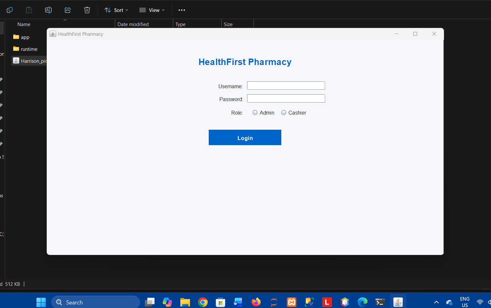

# HealthFirst-PIMS
HealthFirst PIMS is a Java-based Pharmacy Inventory Management System developed to help manage pharmacy operations. The system allows administrators to manage medicines, suppliers, and cashier accounts, while cashiers can assist with sales and checkout operations.

The project was developed as part of my Information Technology studies to practise Java programming, database management, and graphical user interface development.

## Screenshots

Check out more screenshots in the ScreenShots folder to see all the validations.

## Features
- Role-based login (Admin and Cashier)
- Medicine, Supplier and User management (CRUD)
- Point of Sale with cart system
- Billing and receipt generation
- Sales and Expiry reports
- Automatic stock update on payment

## Tech Stack
- Java (Swing/AWT)
- MySQL (JDBC)
- NetBeans IDE

## How to Run
1. Import `database.sql` into MySQL via phpMyAdmin
2. Open project in NetBeans
3. Update `DatabaseConnection.java` with your MySQL password
4. Run `frame1.java` this is the login page

## Default Login Credentials
| Role | Username | Password |
|------|----------|----------|
| Admin | admin | admin123 |
| Cashier | cashier | cash123 |

## Screenshots
(add screenshots here)
